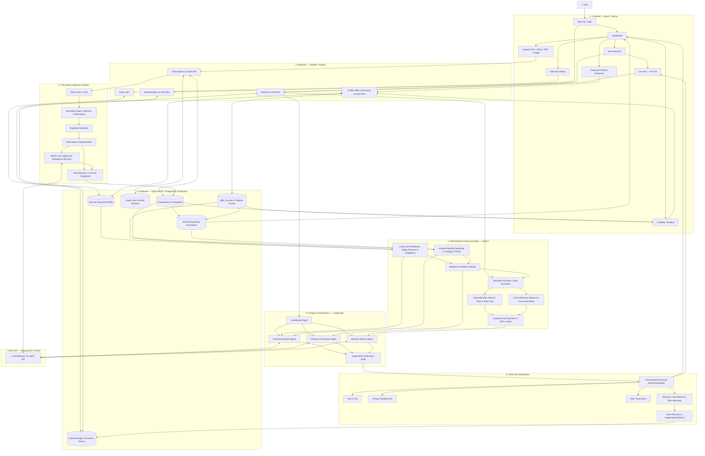

# Spendly 💳
> **AI-Powered Personal Finance & Pre-Purchase Decision Engine**
> Built for the Hackathon Demo & Prototype.

Spendly solves a fundamental personal finance dilemma: **"Can I afford this right now without breaking next month's essentials?"**

Instead of merely tracking where your money went in the past, Spendly is a forward-looking pre-purchase guardrail. It calculates your true **Safe to Spend Today** balance, tracks upcoming essential bills, and runs instant multi-scenario financial impact analyses before you swipe your card.

---

## 🌟 Core Features

- **Real-Time "Safe to Spend Today" Engine**:
  $$\text{Safe to Spend} = \text{Current Savings} - \text{Upcoming Essentials} - \text{Secure Reserve Buffer}$$
- **Interactive Bill & Expense Manager**:
  - Add manual recurring/one-off bills (Rent, EMI, Rasan/Groceries, Credit Cards, Housekeeper, Utilities, Medical, etc.).
  - Dark-mode date picker with quick date offsets (`Today`, `+7 Days`, `+15 Days`, `+1 Month`).
  - Toggle bill inclusion and mark bills as paid in real-time.
- **Dynamic Cash Flow & Timeline Forecast**:
  - Daily projected balance timeline showing impact of due bills and paycheck dates.
- **AI Decision Simulator**:
  - Run purchase simulations with verdict levels: **Safe**, **Caution**, or **High Risk**.
  - Calculates balance after purchase and evaluates impact on upcoming essential commitments.
- **Zero-State & User Authentication**:
  - User registration & login with JWT bearer tokens.
  - PBKDF2-HMAC-SHA256 password hashing.
  - Starts with clean zero data so each feature can be tested directly from the UI.

---

## 🗺️ End-to-End System Flowchart



---

## 🏗️ Architecture

```
SPENDLY/
├── backend/
│   └── src/
│       ├── api/               # FastAPI route controllers
│       │   ├── routes_dashboard.py
│       │   ├── routes_expenses.py
│       │   ├── routes_profile.py
│       │   └── routes_decisions.py
│       ├── auth/              # JWT Auth & Security
│       │   ├── jwt.py
│       │   ├── utils.py
│       │   ├── dependencies.py
│       │   └── routes.py
│       ├── db/                # SQLite & SQLAlchemy models
│       │   ├── database.py
│       │   ├── models.py
│       │   └── init_db.py
│       ├── engine/            # Financial math & timeline engine
│       │   └── calculator.py
│       └── main.py            # FastAPI application entry point
├── frontend/
│   ├── src/
│   │   ├── components/        # React components (Dashboard, Expenses, Timeline, etc.)
│   │   ├── api.js             # REST API client with JWT bearer tokens
│   │   ├── App.jsx            # Main app shell & view state
│   │   └── index.css          # Glassmorphism dark-mode design system
│   └── package.json
```

---

## 🚀 Getting Started

### 1. Prerequisites
- Python 3.10+
- Node.js 18+ and npm

### 2. Backend Setup
```bash
# Navigate to project root
cd SPENDLY

# Install Python dependencies
pip install fastapi uvicorn sqlalchemy pydantic pyjwt

# Run the backend API server (runs on port 8000)
python -m uvicorn backend.src.main:app --host 127.0.0.1 --port 8000 --reload
```
API Documentation will be available at: `http://127.0.0.1:8000/docs`

### 3. Frontend Setup
```bash
# Navigate to frontend folder
cd frontend

# Install dependencies
npm install

# Start Vite development server (runs on port 5173)
npm run dev
```
Open `http://localhost:5173` in your browser.

---

## 🧪 Manual Testing & Zero-Data Mode

Spendly starts with **clean zero data**.
1. Open `http://localhost:5173`.
2. Click **Create an account** (or Login).
3. Set up your profile (Salary, Current Savings, Secure Minimum Reserve).
4. Add your upcoming bills (Rent, EMI, Rasan, etc.) with custom due dates.
5. Watch your **Safe to Spend Today** metric and Timeline update automatically!
